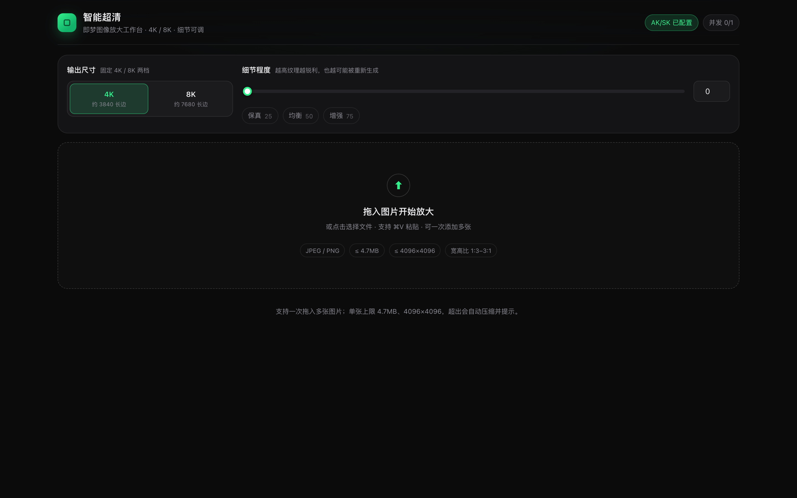
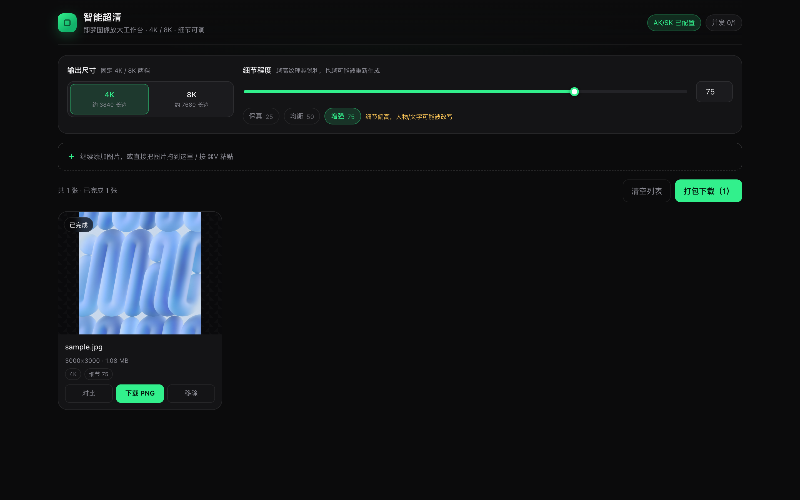
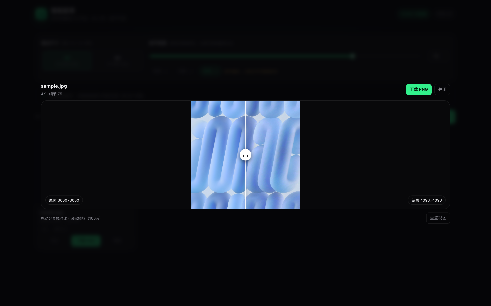

# 即梦智能超清 · 图像放大工作台

基于火山引擎「即梦 AI 智能超清」接口的本地图像放大工具：批量上传图片，选择 4K / 8K 输出，细节程度 0–100 可调，实时查看放大前后对比。



## 功能

- **批量放大**：拖拽、点击或 `⌘V` 直接粘贴多张图片，按队列依次处理
- **输出尺寸**：4K（约 3840 长边）/ 8K（约 7680 长边）
- **细节程度**：0–100 滑块 + 保真 / 均衡 / 增强三档预设，实时提示高细节可能改写人物与文字
- **前后对比**：中缝拖动对比、滚轮缩放（1–5 倍）、拖拽平移、一键重置
- **结果落地**：服务端自动下载并保存到本地，不受官方 24 小时链接过期影响；支持单张下载与打包 ZIP 下载
- **失败重试**：区分可重试与不可重试错误，网络抖动不会误判任务失败





## 快速开始

```bash
npm install
cp .env.example .env   # 填入火山引擎 AK/SK
npm run dev            # 打开 http://localhost:5173
```

`.env` 说明：

```ini
VOLC_AK=你的 AccessKey
VOLC_SK=你的 SecretKey
USE_MOCK=0    # 1 = 不调真实接口，用原图模拟结果，便于纯前端联调
API_PORT=8787
```

AK/SK 在火山引擎控制台的「访问控制 IAM → 密钥管理」中获取，只在本机服务端使用，不会进入浏览器。

先验证签名与接口连通性（可选，但推荐）：

```bash
npm run probe -- ./sample.jpg
```

## 实现要点

| 模块 | 说明 |
| --- | --- |
| `server/volc.ts` | 火山 Signature V4 签名、`CVSync2AsyncSubmitTask` 提交与 `CVSync2AsyncGetResult` 轮询、错误码映射 |
| `server/index.ts` | Express 本地代理：上传、任务状态、结果落盘、ZIP 打包、静态资源 |
| `server/store.ts` | 任务与结果的本地持久化（`.data/`） |
| `src/lib/image.ts` | 浏览器端预处理：比例裁切、长边限制、渐进压缩，满足 4.7MB / 4096px 限制 |
| `src/App.tsx` | 任务队列调度：并发控制、指数退避轮询、超时判定、自动重试 |

接口约束：JPEG / PNG、≤ 4.7MB、≤ 4096×4096、宽高比 1:3–3:1；不满足的图片会在浏览器端自动压缩或裁切后再上传。

## 注意事项

- 该 `req_key` 默认只有 1 个并发额度，同时提交多张会返回 `50430`，因此前端固定按 1 张排队；如需更高并发，可调整 `src/App.tsx` 中的 `CONCURRENCY`
- 4K 单张约 1 分钟，8K 单张约 4–6 分钟
- 结果文件保存在 `.data/results/`，该目录与 `.env` 均已在 `.gitignore` 中忽略

## 脚本

```bash
npm run dev     # 同时启动本地 API（8787）与前端（5173）
npm run build   # 类型检查 + 生产构建
npm start       # 以生产模式运行（托管 dist 与 API）
npm run probe   # 用真实 AK/SK 跑一次完整放大流程
```
